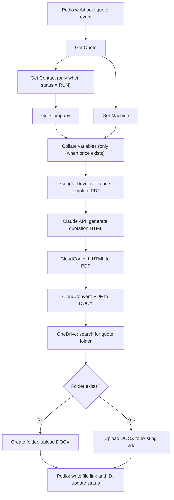

# AI Quotation Pipeline (Podio, Claude, Make)

A Make.com scenario that turns a Podio quote record into a finished, branded sales quotation. A salesperson sets the quote to run, and a few moments later the document is in the company's OneDrive and linked back on the Podio record.

Built for a B2B machinery sales company. Client name, IDs, credentials and internal folder paths are removed from this write-up.

## The problem

Quotations for industrial machinery are long, structured documents: buyer details, equipment description, machine photos, a technical specification table, commercial terms, and a final price page. Each one had to be assembled by hand from data that already lived in the CRM (quote, contact, company and machine records), then formatted, converted and filed.

## What I built

An end-to-end scenario in Make that:

1. Starts from a Podio webhook when a quote item changes.
2. Pulls the related records: the quote, the contact, the company and the machine.
3. Collates everything into one clean set of variables (buyer, equipment, terms, price, photos, salesperson, date).
4. Fetches a reference template PDF so the output matches the company's real quote design.
5. Sends the data and the template to the Claude API, which returns one complete, print-ready HTML document.
6. Converts the HTML to PDF, then the PDF to an editable DOCX, using CloudConvert.
7. Finds or creates the quote's folder in OneDrive and uploads the DOCX.
8. Writes the OneDrive link and file ID back to the Podio quote and updates its status.

## Architecture



## Tech stack

| Layer | Tool |
| --- | --- |
| Orchestration | Make.com |
| Source of truth | Podio (Quotes, Contacts, Companies, Machines apps) |
| AI generation | Claude API (Anthropic) |
| Template storage | Google Drive |
| Document conversion | CloudConvert |
| Document storage | Microsoft OneDrive |

## Design decisions

**Guard conditions, not blind runs.** The scenario only continues when the quote's status is set to run, the company record exists, and a price is filled in. An incomplete quote never reaches the AI step, so nothing half-finished gets generated.

**The AI is given a real template.** The reference quote PDF is passed to Claude as a document alongside the data, so the layout follows the company's actual design rather than a generic one.

**A long, structured system prompt.** The prompt (about 25,000 characters) defines the output contract (raw HTML only, no commentary), the page format and margins, the visual style, the section order, data rules (for example, never invent a VAT number or fill a missing field with a placeholder), image placement and pagination, and a final validation checklist.

**Data treated as data.** The prompt includes an instruction-priority and data-security section so that text coming from CRM fields cannot override the generation rules. HTML escaping rules protect the document from broken markup in field values.

**Low temperature.** The model runs at a low temperature with thinking disabled, because a quotation needs consistency, not creativity.

**HTML first, then PDF, then DOCX.** HTML gives precise layout control. The PDF is the faithful render, and the DOCX is what the sales team can still edit. The prompt includes specific DOCX conversion requirements so the editable version holds its layout.

**Safe re-runs.** The scenario searches for the quote's folder before creating one, so re-running a quote does not create duplicate folders. Uploads are set to fail on a name conflict instead of silently overwriting an existing file.

**Failure handling.** The scenario has a maximum error count and incomplete executions are stored so a failed run can be inspected and resumed instead of being lost.

## Problems solved during the build

- **Content block configuration:** getting the template PDF and the data into the correct message structure for the Claude module.
- **Base64 encoding:** passing the template file and the generated HTML between modules as binary data without corruption.
- **Image pairing layouts:** laying out machine photos in pairs across pages without splitting a pair or leaving a page half empty.
- **Caption removal:** stopping the model from adding unwanted captions under photos, and keeping the layout stable after removal.

## Inputs and outputs

**Input:** a Podio quote item with linked contact, company and machine records, plus the commercial fields (price, payment terms, delivery time, installation, pickup location, condition) and up to five machine photo URLs.

**Output:** a branded DOCX quotation stored in a folder named after the quote, and a link to it on the Podio quote.

## Structure of this folder

```
quotation-pipeline/
  README.md
  screenshots/
    scenario-overview.png
    sample-quotation.png
```

The raw Make blueprint is not included, because it contains internal IDs and the client's full prompt.

## Author

Holiness Ihedinma Onyemaechi
Holiness Automation Consulting
Portfolio: https://holiness-ihedinma-o.github.io/
Book a call: https://calendly.com/holinessonyemaechi
